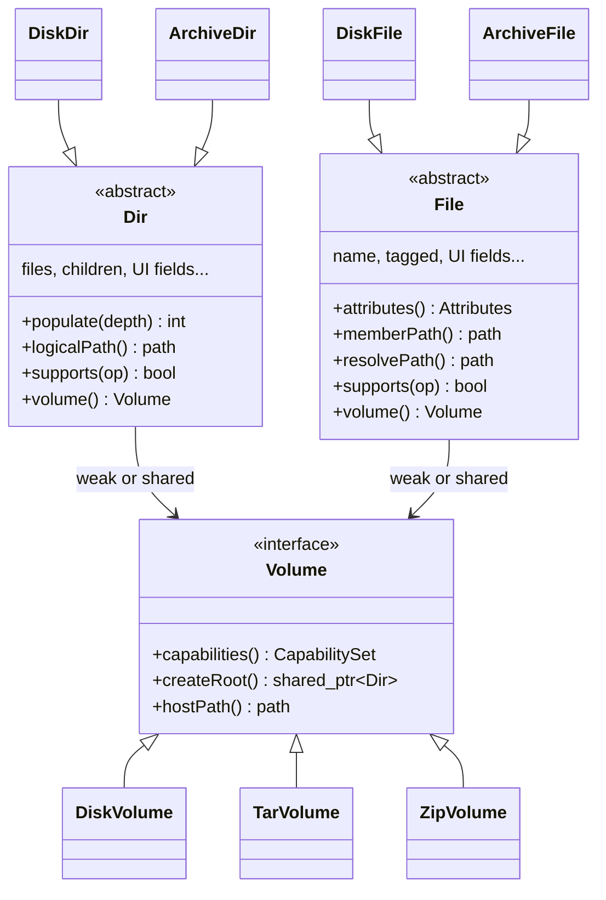

# Dir / File class transition plan

Plan for transitioning legacy `DirEntry` and `FileEntry` structs into overridable C++ classes **`Dir`** and **`File`** for better platform portability (Windows) and archive browsing (including nested archives). Skeleton headers live under `src/entries/` (`metadata.hpp`, `dir.hpp`, `file.hpp`).

## What you are really separating

Today three concerns live in the same structs:

| Concern | Examples in current code |
|--------|---------------------------|
| **Tree / UI state** | `tagged`, `matching`, `cursor_pos`, `total_bytes`, `global_flag` |
| **Display metadata** | `name`, `stat_struct`, `symlink_target` |
| **Backend semantics** | Disk: `ReadTree`, `DoStat`, `chmod`; Archive: `GetRealFileNamePath` + extract pipelines, `mode != DISK_MODE` guards |

The first refactor goal is to keep (1) and (2) on the node classes while moving (3) behind overridable methods and a **`Volume`** (or **`TreeBackend`**) object that outlives “which global `Mode` are we in?”.

---

## Target shape (initial, not final)



Each **`Statistic::tree`** root should be created by a **`Volume`**, not `std::make_shared<DirEntry>()`, so nested archives later become “this **`File`** opens a child **`Volume`**” instead of another global mode. During migration, **`DirEntry` / `FileEntry`** can remain as typedefs or thin aliases to **`Dir` / `File`** until call sites are updated.

---

## Layer 1: Portable metadata (`Attributes`)

Stop exposing `struct stat` as the long-term public face of entries. Keep it internally on Unix for now; wrap it for the UI and sorting.

```cpp
// src/entries/metadata.hpp
class Attributes {
public:
  enum class Type {
    Block, Char, Directory, Fifo, Regular, Socket, Symlink, Unknown,
  };

  static Attributes FromStat(const struct stat& st);  // Unix impl first

  bool IsDirectory() const;
  bool IsSymlink() const;

  // size, permission_bits, timestamps, owner/group — fill in as migration proceeds
};
```

**Initial step:** add `File::Attributes() const` that returns **`Attributes`** built from `stat_struct`, and migrate display/sort code to use it gradually. Windows later implements `FromStat` (or a parallel factory) via `std::filesystem` / Win32 without touching every caller.

---

## Layer 2: `File` and `Dir` as polymorphic nodes

Keep the existing ownership model (`children` / `files` own `shared_ptr`s; `parent` / `dir` stay `weak_ptr`). Add a **virtual destructor** and a small set of hooks—enough to replace `Mode` checks and centralize path logic.

### Shared base (UI + tree wiring unchanged at first)

```cpp
// src/entries/file.hpp
class File {
public:
  enum class Operation {
    Chmod, Chown, CopyIn, CopyOut, Delete, Edit, Execute, Pipe, Rename, Tag, View,
  };

  std::weak_ptr<Dir> dir;
  bool tagged = false;
  bool matching = false;
  std::string name;
  std::string symlink_target;
  struct stat stat_struct{};  // deprecate gradually

  virtual ~File() = default;
  virtual NodeKind Kind() const = 0;
  virtual std::shared_ptr<Volume> GetVolume() const = 0;

  virtual Attributes Attributes() const;
  virtual std::filesystem::path MemberPath() const;
  virtual std::filesystem::path ResolvePath() const;  // replaces GetRealFileNamePath for this entry

  virtual bool Supports(Operation op) const;

  virtual std::shared_ptr<Volume> OpenNestedVolume() const { return nullptr; }
};
```

```cpp
// src/entries/dir.hpp
class Dir : public std::enable_shared_from_this<Dir> {
public:
  enum class Operation {
    Chmod, Chown, Mkdir, Navigate, Rename, Rmdir, Scan,
  };

  std::weak_ptr<Dir> parent;
  std::vector<std::shared_ptr<File>> files;
  std::vector<std::shared_ptr<Dir>> children;
  // ... totals, flags, name, stat_struct, cursor_pos, etc.

  std::shared_ptr<Dir> Parent() const { return parent.lock(); }

  virtual ~Dir() = default;
  virtual NodeKind Kind() const = 0;
  virtual std::shared_ptr<Volume> GetVolume() const = 0;

  virtual Attributes Attributes() const;
  virtual std::filesystem::path LogicalPath() const;  // replaces GetPath for this subtree anchor

  /** Disk: ReadTree; Archive dir: usually no-op (children already inserted). */
  virtual int Populate(const std::filesystem::path& scan_root, int depth);

  virtual bool Supports(Operation op) const;

  virtual std::shared_ptr<File> MakeFileEntry();
  virtual std::shared_ptr<Dir> MakeDirEntry();
};
```

**Two concrete pairs to start with** (matches today’s two builders):

| Type | `Populate` | `ResolvePath` / paths | `Supports` |
|------|------------|------------------------|------------|
| **`DiskDir` / `DiskFile`** | `directory_iterator` + `DoStat` (current `ReadTree`) | Real filesystem paths under login root | Full mutating ops where OS allows |
| **`ArchiveDir` / `ArchiveFile`** | No-op or lazy future | Member path under archive root; host file via `Volume::HostPath()` + extract commands | View/copy-out/pipe where profiles allow; no chmod on member |

Archive nodes hold (or reach through **`Volume`**) **`member_path`**—the string today’s `InsertArchiveFileEntry` already knows—so `GetPath()`-style walking and archive-specific `/` root naming live in **`ArchiveDir::LogicalPath()`** overrides instead of special cases in `util.cpp`.

---

## Layer 3: `Volume` (replaces global `Mode` over time)

```cpp
// volume/volume.hpp
class Volume : public std::enable_shared_from_this<Volume> {
public:
  virtual ~Volume() = default;

  virtual VolumeKind Kind() const = 0;
  virtual std::filesystem::path HostPath() const = 0;  // file on disk or mount point
  virtual CapabilitySet Capabilities() const = 0;

  virtual std::shared_ptr<Dir> CreateRoot();

  virtual std::string MakeViewCommand(const File& member) const;
  virtual std::string MakeExtractCommand(const File& member, const std::filesystem::path& dest) const;
};
```

Implement **`DiskVolume`**, **`TarVolume`**, **`ZipVolume`**, … by moving the bodies of `ReadTree` / `ReadTreeFromZIP` / login’s mode dispatch into `CreateRoot()` (or `LoadInto(root)`). **`login.cpp`** becomes: detect format → `statistic.volume = MakeVolume(...)` → `statistic.tree = volume->CreateRoot()` instead of a 12-way `Mode` branch driving behavior everywhere.

Keep **`enum class Mode`** temporarily as a thin mapping from **`VolumeKind`** so you do not rewrite every file at once.

---

## Nested archives (design hook, not day-one work)

On **`ArchiveFile`**, override:

```cpp
std::shared_ptr<Volume> OpenNestedVolume() const override;
```

If `name` / magic sniffing says “zip inside tar”, return a **`ZipVolume`** whose **`HostPath()`** is either the outer archive plus member path or a temp extracted blob. UI action “enter archive” attaches a child tree (new tab/window or replace subtree—product choice later) without another global mode.

Lazy browsing: **`ArchiveDir::Populate`** could someday mean “read central directory for this prefix only”; today’s full-tree parse moves into **`Volume::LoadMembers(prefix)`** behind the same interface.

---

## Operations map (where virtuals land)

| Current entry point | Becomes |
|--------------------|---------|
| `ReadTree(de, path, depth)` | `de->Populate(path, depth)` on **`DiskDir`** |
| `InsertArchive*Entry` | **`ArchiveVolume::InsertMember(...)`** + **`MakeFileEntry`/`MakeDirEntry`** |
| `GetPath` / `GetRealFileNamePath` | `LogicalPath()` / `ResolvePath()` |
| `if (mode != DISK_MODE)` in rename/copy/chmod | `Supports(op)` or `volume->Capabilities()` |
| `MakeExtractCommandLine` | `volume->MakeExtractCommand(...)` |

Walkers (`walker.hpp`) can stay on legacy **`FileEntry*`** (or **`File*`**) until you add a walk helper on **`File`**; not required for the first class transition.

---

## Migration phases (safe order)

1. **Mechanical class shell** — legacy `struct DirEntry` / `FileEntry` → **`Dir` / `File`** with `virtual ~`; keep **`using DirEntry = Dir`** / **`using FileEntry = File`** (or inheritance) so most code compiles unchanged at first.
2. **`Attributes` + virtual accessors** — implement on base using current `stat_struct`; no behavior change.
3. **Introduce `DiskDir` / `DiskFile` and `ArchiveDir` / `ArchiveFile`** — factories in `readtree.cpp` / `archive.cpp` use `std::make_shared<DiskDir>()` instead of `make_shared<DirEntry>()`.
4. **`Volume` + login** — one archive format end-to-end (e.g. ZIP) to prove the pattern; leave others calling old functions from `ZipVolume` internally.
5. **Redirect path helpers** — `GetPath(de)` → `de->LogicalPath()` (free functions can delegate for compatibility).
6. **Capability checks** — replace scattered `Mode` tests in rename/delete/chmod/filewin messages.
7. **Windows** — new **`DiskVolume`** / **`DiskFile`** implementation file; POSIX-specific code stays in `disk_posix.cpp` (or `#if` only inside overrides).
8. **Retire struct assignment in `MinimizeArchiveTree`** — `*tree = *child` is **object slicing** once types are polymorphic; replace with “promote child into root” that moves vectors and re-parents pointers, or restrict minimize to **`ArchiveDir`** only.

---

## File layout suggestion

```
src/entries/
  metadata.hpp          # Attributes
  dir.hpp / dir.cpp     # Dir + Dir::Operation
  file.hpp / file.cpp   # File + File::Operation
  disk.hpp / disk.cpp   # DiskDir, DiskFile
  archive.hpp / archive.cpp  # ArchiveDir, ArchiveFile
src/volume/
  volume.hpp
  disk_volume.cpp
  tar_volume.cpp
  zip_volume.cpp
  ... (or one archive_volume.cpp delegating to existing tar.cpp/zip.cpp)
```

Keep **`ytree.h`** including the public headers (and temporary **`DirEntry`/`FileEntry`** aliases if needed) so the rest of the codebase still compiles during transition.

---

## What to implement first (minimal vertical slice)

Smallest useful milestone:

1. **`Attributes`**, **`File`/`Dir`** bases with **`Kind()`**, **`GetVolume()`**, **`ResolvePath()`**, **`Supports()`**.
2. **`DiskDir::Populate`** = move `ReadTree` body; **`ArchiveFile::ResolvePath`** = current `GetRealFileNamePath` archive branch.
3. **`DiskVolume::CreateRoot`** for normal directory login only.
4. One **`ZipVolume::CreateRoot`** wired from login; **`Capabilities()`** drives the existing “Feature not available in archives” behavior from one place.

That gives overridable nodes and a backend object without rewriting every archive format or the dir/file windows in one pass.

---

## Design choices to decide early

- **Volume pointer storage:** `shared_ptr<Volume>` on the root **`Dir`**, children call `root->GetVolume()` vs each node carrying `weak_ptr<Volume>`. Prefer **weak on every node** if you later mount nested volumes on a single file without rebinding the whole tree.
- **Child factory:** **`Dir::MakeFileEntry()`** / **`Dir::MakeDirEntry()`** virtual ensures archive dirs never accidentally insert **`DiskFile`** instances.
- **Path type:** stay on **`std::filesystem::path`** internally; archive member paths may stay **`std::string` with `/`** internally even on Windows, and normalize only at extract/view boundaries (matches today’s `Fnsplit`).
- **Naming vs POSIX:** **`File::Attributes()`** returns type **`Attributes`**; consider renaming the method (e.g. **`Metadata()`**) if the duplicate word **`Attributes`** becomes noisy in call sites.
